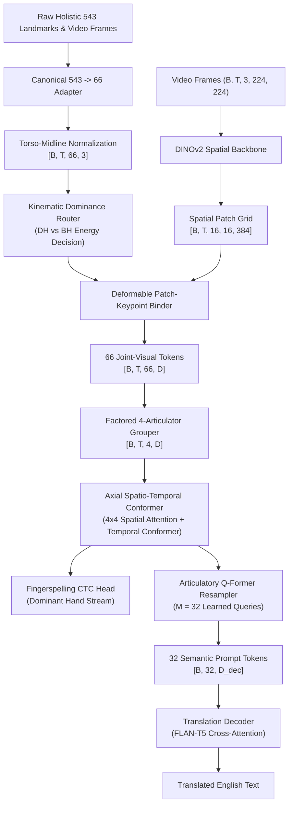

# Articulatory-Bound Spatiotemporal Transformer (AB-ST)
## Mathematical Specification & Architecture Whitepaper

---

### 1. Executive Summary & Design Rationale

Prior deep sign language architectures, notably ISL-MEGA (`DINOv2-PoseGraph-3DCNN-Conformer`), suffered from four fatal architectural flaws:
1. **The 1D CLS Bottleneck**: Visual frames ($224 \times 224 \times 3$) were reduced to a single global 1D token ($1 \times 384$), discarding spatial coordinates of active hands, facial expressions, and mouthings.
2. **Left/Right & Asymmetric Hand Ambiguity**: Naive bilateral graph convolution without hand dominance or role routing caused catastrophic errors whenever left-handed signers or asymmetric two-handed signs were encountered.
3. **Lossy Temporal Downsampling**: Temporal pooling ($T \to T/2$) and unpooling caused frame misalignment and destroyed brief, critical fingerspelling phonemes (1-3 frames).
4. **Context Bloat & LLM Hallucination**: Directly injecting raw spatio-temporal sequences into autoregressive decoders without linguistic bottlenecking led to attention collapse and language prior over-reliance.

**AB-ST (Articulatory-Bound Spatiotemporal Transformer)** eliminates every one of these bottlenecks by grounding neural sequence modeling in **Sign Language Phonology** (Brentari, 1998; Sandler & Lillo-Martin, 2006):
- Space is centered on the signer's torso ($p_{\text{mid}}(t)$).
- Hands are dynamically routed into **Dominant (DH)** and **Base (BH)** articulators based on kinetic energy.
- 2D visual patches from DINOv2 are bound directly to 3D skeletal landmarks via continuous deformable bilinear sampling.
- Articulators are modeled via an **Axial Spatio-Temporal Conformer** with zero temporal downsampling.
- An **Articulatory Q-Former** condenses continuous video into $M = 32$ discrete linguistic prompt tokens feeding cross-attention in the text decoder.

---

### 2. Formal Mathematical Formulation

#### 2.1 Dynamic Torso-Midline Normalization
Let $P(t) \in \mathbb{R}^{66 \times 3}$ be the canonical landmarks at frame $t$.
Let $p_{42}(t)$ and $p_{43}(t)$ denote the left and right shoulder coordinates.
The dynamic midpoint and instantaneous shoulder distance are:
$$p_{\text{mid}}(t) = \frac{p_{42}(t) + p_{43}(t)}{2}$$
$$w_{\text{inst}}(t) = \|p_{42}(t)[:2] - p_{43}(t)[:2]\|_2$$

To prevent frame-to-frame jitter from noisy landmark detections, the scale is smoothed causally:
$$\bar{w}(t) = \alpha \bar{w}(t-1) + (1 - \alpha) w_{\text{inst}}(t), \quad \alpha = 0.95$$
The normalized coordinate for each landmark $j \in \{0 \dots 65\}$ is:
$$\hat{p}_j(t) = \frac{p_j(t) - p_{\text{mid}}(t)}{\bar{w}(t) + \epsilon}$$

#### 2.2 Kinematic Dominance Routing
For left hand $L = \{0 \dots 20\}$ and right hand $R = \{21 \dots 41\}$:
$$E_L = \sum_{t=2}^T \sum_{j \in L} \|\hat{p}_j(t) - \hat{p}_j(t-1)\|^2$$
$$E_R = \sum_{t=2}^T \sum_{j \in R} \|\hat{p}_j(t) - \hat{p}_j(t-1)\|^2$$

The active hand is routed to the Dominant Hand (DH) stream:
$$\text{DH} = \begin{cases} R & \text{if } E_R \ge E_L \\ L & \text{if } E_L > E_R \end{cases}, \quad \text{BH} = \begin{cases} L & \text{if } E_R \ge E_L \\ R & \text{if } E_L > E_R \end{cases}$$
Learned role embeddings $e_{\text{role}} \in \{e_{\text{dom}}, e_{\text{base}}\}$ are added to disambiguate hand roles during symmetric vs. asymmetric signing.

#### 2.3 Deformable Keypoint-Guided Patch Binding
Given DINOv2 feature grid $F_{\text{patch}} \in \mathbb{R}^{B \times T \times 16 \times 16 \times C_{\text{vis}}}$ and normalized coordinates $\hat{p}_j(t)$:
$$\Delta p_j(t) = \tanh(\text{MLP}_{\text{offset}}(\hat{p}_j(t))) \cdot \delta_{\max}$$
Continuous bilinear sampling extracts patch feature $v_j(t)$ at location $\tilde{p}_j(t) + \Delta p_j(t) \in [-1, 1]^2$:
$$v_j(t) = \text{GridSample}(F_{\text{patch}}(t), \tilde{p}_j(t) + \Delta p_j(t))$$
The joint token is fused as:
$$z_j(t) = \text{LayerNorm}(W_{\text{vis}} v_j(t) + W_{\text{pose}} \hat{p}_j(t) + e_j)$$

#### 2.4 Factored 4-Articulator Aggregation
The 66 joint tokens are partitioned into 4 phonological articulators:
1. **Dominant Hand (DH)**: 21 landmarks
2. **Base Hand (BH)**: 21 landmarks
3. **Face / Mouthing (FC)**: 18 landmarks
4. **Torso / Anchor (TR)**: 6 landmarks

Each articulator is pooled using intra-articulator cross-attention with learned query $q_k$:
$$u_k(t) = \text{ArticulatorPooler}_k(\{z_j(t)\}_{j \in \mathcal{A}_k}) + e_{\text{articulator}, k} \in \mathbb{R}^D$$
Yielding tensor $[B, T, 4, D]$.

#### 2.5 Axial Spatio-Temporal Conformer
Each of the $L = 6$ blocks performs:
1. **Spatial Self-Attention ($4 \times 4$)**:
   Allows DH, BH, FC, and TR within each frame $t$ to attend to each other, capturing hand-to-face contacts, bilateral symmetry, and signing space geometry:
   $$X_{\text{sp}}(t) = X(t) + \text{Dropout}(\text{MHSA}(\text{LN}(X(t))))$$
2. **Temporal Conformer**:
   Processes each articulator stream across $T$ frames without downsampling:
   $$X_1 = X_{\text{sp}} + \frac{1}{2} \text{FFN}_1(\text{LN}(X_{\text{sp}}))$$
   $$X_2 = X_1 + \text{MHSA}(\text{LN}(X_1))$$
   $$X_3 = X_2 + \text{Conv1D}(\text{LN}(X_2)) \quad (\text{kernel}=31)$$
   $$X_4 = X_3 + \frac{1}{2} \text{FFN}_2(\text{LN}(X_3))$$
   $$X_{\text{out}} = \text{LN}(X_4)$$

#### 2.6 Multi-Task Fingerspelling CTC Branch
Branches directly from the Dominant Hand trajectory:
$$\mathcal{L}_{\text{CTC}} = \text{CTCLoss}(\text{Linear}(u_{\text{DH}}(1:T)), \mathbf{y}_{\text{fingerspelling}})$$

#### 2.7 Articulatory Q-Former Resampler
A set of $M = 32$ learnable linguistic query vectors $Q \in \mathbb{R}^{32 \times D_q}$ cross-attend to all $4T$ spatiotemporal tokens:
$$Z_{\text{prompt}} = W_{\text{out}} \cdot \text{QFormer}(Q, X_{\text{out}}) \in \mathbb{R}^{B \times 32 \times D_{\text{dec}}}$$

#### 2.8 Text Decoder Cross-Attention
The prompt tokens $Z_{\text{prompt}}$ feed directly into the cross-attention layers of `FLAN-T5-base` with causal target shifting and label-smoothed cross entropy:
$$\mathcal{L}_{\text{CE}} = -\sum_{i=1}^L \log P(y_i \mid y_{<i}, Z_{\text{prompt}})$$

$$\mathcal{L}_{\text{total}} = \mathcal{L}_{\text{CE}} + \lambda_{\text{ctc}} \mathcal{L}_{\text{CTC}} + \lambda_{\text{offset}} \mathcal{L}_{\text{offset}}$$

---

### 3. Layer Dimensions & Parameter Budget

| Component | Input Shape | Output Shape | Parameters |
|---|---|---|---|
| DINOv2 Spatial Backbone | $(B, T, 3, 224, 224)$ | $(B, T, 16, 16, 384)$ | 21.8M (Frozen) |
| Torso Normalization & Router | $(B, T, 66, 3)$ | $(B, T, 66, 3)$ | $<100$ |
| Deformable Patch-Keypoint Binder | $(B, T, 16, 16, 384) + (B, T, 66, 3)$ | $(B, T, 66, 256)$ | 0.22M |
| Factored 4-Articulator Grouper | $(B, T, 66, 256)$ | $(B, T, 4, 256)$ | 0.54M |
| Axial Spatio-Temporal Conformer (6 layers) | $(B, T, 4, 256)$ | $(B, T, 4, 256)$ | 4.85M |
| Fingerspelling CTC Head | $(B, T, 256)$ | $(T, B, 64)$ | 0.02M |
| Articulatory Q-Former (4 layers, $M=32$) | $(B, 4T, 256)$ | $(B, 32, 768)$ | 6.42M |
| FLAN-T5 Decoder Adapter | $(B, 32, 768) + (B, L)$ | $(B, L, 32128)$ | ~100M (Trainable) |
| **Total Active Trainable Parameters** | — | — | **~112M** |

