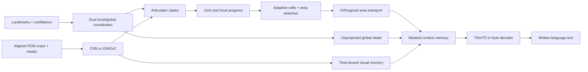

# PCAT-SLT v0.3: visual, multirate, bounded-area transport

A complete research implementation with optional RGB and pretrained text, incorporating the supplied audit and a further correctness review. It is **not** a proof of state-of-the-art translation or universal perfection. [Audit decisions](docs/history/AUDIT_RESPONSE.md) distinguish real defects from unsupported claims. The full v0.2 proofs/specification remain in [history](docs/history/ARCHITECTURE_V2.md).

## 1. Inputs and representations

Inputs are an admitted variable-length sequence of landmarks P∈R^(T×J×3), confidence c∈[0,1]^(T×J), strictly increasing physical timestamps, and optionally aligned RGB crops V∈[0,1]^(T×R×3×H×W) with observation masks. Default crop roles are left hand, right hand, mouth and eyes, routed to the configured articulators. Crop boxes are **explicit 2D image observations**, not assumed projections of arbitrary 3D coordinates.

`depth_policy: use` consumes a shared Euclidean 3D frame; constant proper-similarity invariance is conditional on that representation. `depth_policy: ignore` discards z and operates on consistent image-plane coordinates. It does not pretend that local monocular depth estimates form calibrated 3D geometry.

A fixed anatomical reference gives global coordinates F=B₀ᵀ(P−o₀)/s₀. It retains torso movement relative to the reference. Reliable-reference selection, handedness and missing-data policies are described in `docs/DATA.md`. With `allow_unanchored_rgb: true`, clips without a suitable body frame may fall back to observed RGB; all canonical geometry/confidence is then marked absent. A sample with neither usable geometry nor observed pixels is rejected.

## 2. Dual body coordinates without erasing body motion

In dual mode, local body state is updated from reliable torso anchors. With time constant τ and elapsed time Δt_i,

α_i=exp(−Δt_i/τ),

o_i=α_i o_(i−1)+(1−α_i)o_i^obs,

and similarly for shoulder width. Invalid anchor observations use zero update weight. Smoothed axis vectors are reorthogonalized; degenerate interpolated axes fall back to the preceding valid axes. Local coordinates are B_iᵀ(F_i−o_i)/s_i.

Unlike the review's irreversible centering proposal, the model **also retains the original global canonical frame vector** in unprojected detail memory and exposes local origin, axes, log-width and reliability as motion tokens. Dual mode therefore requires detail memory. Physical torso movement is not forcibly discarded before the decoder.

EMA updates are causal conditional on the supplied global representation. The whole model still uses an offline reference, whole-clip clocks and attention; it is not a streaming system. Dynamic coordinates are not covered by the fixed-frame exact-refinement theorem, and smoothing is not guaranteed to separate camera movement from signing.

## 3. Real visual observations and pretrained decoding

Each valid crop is encoded by a spatial-grid CNN or an optional DINOv2 backbone. Invalid/padded pixels are never passed through the image encoder. Features v_i^r route to pose streams through learned gated affine projections:

z_i^a=W_a vec([local_or_global_P_i^a,c_i^a])+b_a
      +tanh(g_a) mean_(r→a,observed) Uv_i^r.

Separate visual-memory tokens preserve access to the encoded crop observations without forcing them entirely through a small pose rank. Optional visual LayerNorm calibrates their scale relative to normalized coarse tokens. CNN grid pooling retains more spatial arrangement than a single global mean.

Appearance/motion memories receive **explicit time or frame positions** in addition to geometric progress. This is essential when pose progress is zero: otherwise changing frames could be treated as an unordered set. Observation and padding masks are preserved throughout.

The pretrained text adapter supports verified T5/mT5 architectures, including FLAN-T5. PCAT memories are projected to d_model and passed as `BaseModelOutput(last_hidden_state=...)` with the source attention mask. Proper tokenizer IDs, decoder-start handling, target masks and external token-normalized loss are used; T5's PAD start token remains visible. Unused text-encoder transformer blocks are removed because PCAT supplies encoder memory. Freezing the decoder weights still allows gradients to flow through it into PCAT.

The byte decoder remains an offline controlled baseline, including its strict UTF-8 generation constraint. Other pretrained families are explicitly rejected instead of guessing their shifting/language-token conventions. Adding a language prior does not guarantee a BLEU gain or adequate translation.

## 4. Joint and local clocks

For concatenated articulator state z, a bounded learned diagonal metric M defines shared segment length

ℓ_i=√(Δz_iᵀMΔz_i), L=Σ_i ℓ_i.

Weights use bounded log-parameters followed by positive-floor and mean normalization, so cond(M)≤κ for finite parameters. The joint path retains cross-articulator chronology; it does **not** force articulators to move simultaneously.

Optional local streams compute progress descriptors separately within each articulator, while the joint stream remains present. The decoder thus sees local motion structure alongside cross-channel order and physical timing. It is not made invariant to all independent retimings. Such a universal quotient would destroy some meaningful coordination; the original two-channel counterexample still applies.

A fixed scale pyramid remains available. Adaptive mode chooses, independently for each example,

K_b=clip(ceil(L_b/δ),K_min,K_max).

The last pyramid scale is replaced by K_b; earlier scales remain. Per-example results are padded and **masked in both source context attention and decoder attention**. Tokens are not allocated using another batch member's length. Adaptive counts are nondifferentiable at thresholds, capped, and geometric rather than linguistic segmentation. Detail memory retains every admitted observed frame regardless of K.

## 5. Bounded-dimensional area sketches

Dense chronological area in N channels costs quadratic storage. V0.3 optionally uses h fixed reproducible column-orthonormal projections P_j∈R^(N×d), d≪N. All heads retain the **original full-state common clock**:

x_i^j=P_jᵀz_i,

H_k^j=½ Σ_(u<v in cell k) (Δx_u^j Δx_v^(j)ᵀ−Δx_v^j Δx_u^(j)ᵀ).

An optional normalized-progress coordinate is appended after projection. Its cell increments use the same original ℓ_i/L, not a newly recomputed sketch clock.

**Exact projected-area theorem.** For the same clipped cell increments, linearity gives H_k^j=P_jᵀH_kP_j. Expand each projected outer product and factor P_j out of the ordered sum. This is an exact identity in real arithmetic, not an approximate integration method. It does not imply that a low-dimensional sketch recovers H_k. For progress augmentation the same statement holds with block-diagonal projection diag(P_j,1).

The clock pass costs O(BTN); projections cost O(BThNd); prefix-area storage/integration costs O(BThd²+BΣK·hd²), plus searches. These replace an N² area with h·d² statistics. Dense and sketched variants remain explicit ablations. Full raw canonical detail still bypasses the learned rank/sketch bottleneck, but the decoder can ignore that evidence and real pose may be wrong.

## 6. Exact prefix integration and its numerical limits

For a path prefix with displacement q and area G, appending fraction β of a straight segment d gives

q'=q+βd,

G'=G+½β(qdᵀ−dqᵀ).

For cell boundaries a,b, D=q_b−q_a and

H_[a,b]=G(b)−G(a)−½(q_aDᵀ−Dq_aᵀ).

**Proof.** Split the ordered double sum into prefix, interval and cross terms. The cross term factors into the wedge of the prefix and interval displacements; rearrangement yields the formula. A straight segment has zero intrinsic skew area. Thus one prefix pass supports exact boundary queries at multiple scales without a per-cell rescan.

The independently implemented clipping backend remains selectable. Prefix subtraction may cancel large numbers, so FP32/FP64 checks and explicit clipping are provided. Dense reference configs use float64 integration; the resource-oriented multimodal example uses float32 with sketches. Neither is universally best. MPS explicitly integrates on CPU and returns features to the model device with autograd preserved; it does not depend on device float64 or an unsupported device solve. Hardware validation is still required.

## 7. Solve-free orthogonal transport

Exact Cayley remains Q(H)=(I−A)^−1(I+A), A=tanh(g)H/(1+||H||_F). Its orthogonality and conditioning proofs are retained. For an ordinary value vector, the implementation now solves (I−A)y=m+Am directly with one right-hand side, rather than constructing Q. Dense Q is formed only for requested diagnostics. Values and gradients are tested against the dense oracle. A truncated Neumann inverse is **not** substituted: the audit counterexample has a 0.12109375 orthogonality defect despite ||A||_F<1.

For the new alternative, let E₀={(0,1),(2,3),…} and E₁={(1,2),(3,4),…}. Each edge (u,v) uses angle

θ_uv=2 atan(tanh(g)H_uv/(1+||H||_F)).

Let G_p(H) be the product of disjoint plane rotations for matching E_p, acting on a value pair as

m'_u=cos(θ)m_u+sin(θ)m_v,

m'_v=−sin(θ)m_u+cos(θ)m_v.

Use the palindromic composition

R(H)=G₀(θ/2) G₁(θ) G₀(θ/2).

The implementation halves the angles, not H, for the outside sweeps. Applied to a value vector, only three disjoint-pair passes are needed after constructing the area and angles. A dense transport matrix is materialized only when requested for diagnostics.

**Orthogonality and reversal theorem.** Every plane rotation has RᵀR=I by cos²θ+sin²θ=1. A product of orthogonal matrices is orthogonal, so value norm is preserved. Negating H negates every angle. Since the schedule is palindromic, negating H also gives the reverse product of inverses, hence R(−H)=R(H)ᵀ. Tests cover several dimensions, numerical gradients and norm/reversal identities.

This is a **different transport family**, not a Cayley approximation or a proven improvement in translation. Sparse matching limits the action's coupling, although all sketched areas are still exposed to the readout. Dense Cayley is an essential comparison. CPU action timings are recorded without extrapolating to CUDA/MPS training speed.

## 8. Guarantees and tradeoffs

Fixed-reference, affine-embedding geometric PCAT retains exact polygonal subdivision invariance in real arithmetic. Inserting a collinear point splits metric length additively, introduces zero same-segment wedge, preserves normalized progress, and leaves the same clipped curve pieces. Linear area sketches preserve this result. Adaptive counts based on ideal L also agree, away from floating-point threshold ambiguity.

The complete visual/dual-frame/timing model is **not** claimed camera, speed or duplicate-frame invariant. Learned image encoders, dynamic normalization, physical timing and explicit frame memories intentionally change that regime. The same distinction applies to independent articulator retiming and geometric versus semantic invariance.

Unprojected global detail tokens retain all admitted canonical coordinates/confidence before decoder attention. RGB fallback marks geometry absent rather than inventing a 3D reconstruction. These are representation guarantees, not guarantees that the model uses the evidence correctly.

## 9. Training, data and reproducibility

Training uses actual nonpadding target-token counts for loss accumulation, optional CUDA AMP, finite-gradient checks, validation-NLL selection, source-file fingerprints, source/group/RGB leakage checks and epoch-boundary resume. Pretrained target vocabularies and PAD/EOS handling are independent of byte tokenization.

Format-3 checkpoints contain architecture snapshots, full active weights and tokenizer files. Reload constructs pretrained modules **from stored configs**, loads their state and restores tokenizer assets locally, without downloading the original model again. Tiny local T5/DINO fixtures test weight loading, gradient flow, generation and offline checkpoint portability; they are not evidence about large pretrained model quality. Format-2 byte checkpoints remain supported when their configuration uses the preserved reference path.

Real annotation importers support PHOENIX-2014T pipe CSV, ISLTranslate `uid,text` CSV plus explicit splits, and CSL-Daily primitive metadata/normalized records. Targets, not glosses, are imported. Prepared observation files must exist. Missing splits are errors; no random split is invented. CISLR is correctly rejected as an isolated-recognition corpus. Corpus access and observation preparation remain external requirements.

## 10. Evidence and remaining questions

[Verification](reports/VERIFICATION.md) records actual tests, failures, corrections, CPU measurements and pixel diagnostics. [Limitations](docs/LIMITATIONS.md) describes remaining risks. The current work does not demonstrate natural-language SLT superiority, trained mouthing/gaze accuracy, fully verified accelerator deployment, universal novelty or a publication outcome. Those claims require the real-data and matched-baseline program in `docs/EXPERIMENTS.md`.
